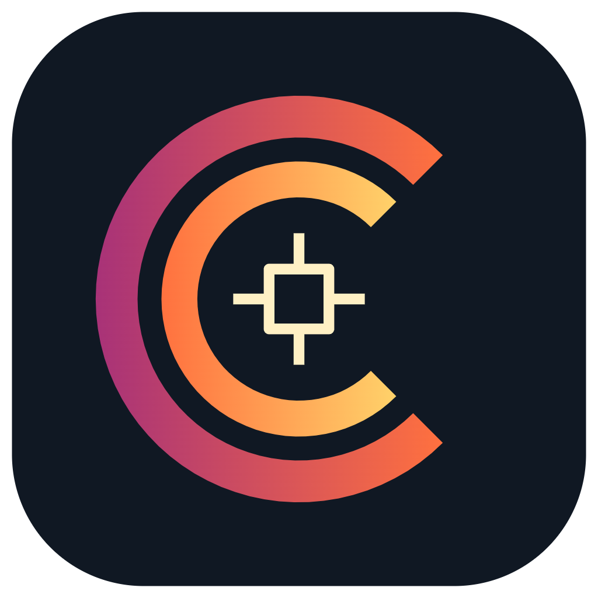

# Caloraview Desktop



A desktop app for the **AccuMEMS SK02** USB thermal camera: live thermal images, temperature markers, video, snapshots, and CSV logging with the original detector data preserved.

[Download a release](https://github.com/doudar/CaloraView/releases) · [Build status](https://github.com/doudar/CaloraView/actions) · [Report an issue](https://github.com/doudar/CaloraView/issues)

## Features

- Reads and caches the connected camera's factory calibration on Windows, then captures an internal shutter reference automatically.
- Displays center, minimum, and maximum temperatures directly on the image, in Celsius or Fahrenheit.
- Starts in HD/AI view and remembers the selected view between sessions. Openly licensed Real-ESRGAN and FSRCNN models run locally; enhancement does not change temperature measurements.
- Estimates reflected temperature once per camera connection from the initial sensor state, with a manual-override checkbox. Emissivity, ambient temperature, humidity, and distance remain configurable.
- Saves PNG snapshots, MP4 video, raw sensor frames, CSV measurements, and capture metadata.

Windows is the hardware-tested platform. The macOS Apple Silicon build is experimental: camera transport needs real-device validation, and factory-download/shutter controls are currently Windows-only. Physical temperature accuracy has not been validated against a traceable reference target. See [platform limitations](docs/MACOS.md) and [radiometry details](docs/radiometry-environment.md).

## Run from source

Install Node.js 22 or newer, then:

```sh
git clone https://github.com/doudar/CaloraView.git
cd CaloraView
npm ci
npm start
```

Installation downloads Electron, ONNX Runtime, and a platform-specific FFmpeg executable. Windows builds the camera-control helper with the installed .NET Framework compiler. Python, Android tooling, and replacement camera drivers are not required for the desktop app.

Connect the SK02, choose it in the device list, and connect. Initialization loads calibration and performs a shutter cycle. Use **Auto calibrate** to request another shutter reference and **Parameters** to adjust environmental inputs. Automatic reflected temperature stays stable across calibration cycles; it is an estimate, not a measured room temperature. Capture files stay local.

## Build and test

```sh
npm run check:repo
npm test
npm run dist:win   # Windows x64 portable executable; build on Windows
npm run dist:mac   # macOS disk image; build on the target Mac
```

Builds go to ignored `dist/`. Unit tests are hardware-free. UI/hardware smoke scripts under `scripts/` can operate the camera; inspect them before running. Release packages are currently unsigned.

Pull requests run tests and build Windows x64 and macOS ARM64 packages. Every successful push to `main` automatically publishes the next patch release, beginning with `v0.1.1`, with both packages and SHA256 checksums. See [release operations](docs/RELEASING.md).

## Repository contents

- `src/`: Electron app, portable processing, renderer, and licensed display models.
- `scripts/`: build, package verification, hardware diagnostics, and original analysis source.
- `test/`: hardware-free tests and synthetic/reference fixtures.
- `docs/`: development, protocol findings, validation scope, and platform limitations.
- `tools/android-calibration-export/`: optional original Android calibration-export helper source.
- `assets/brand/`: original application artwork and editable design.

Vendor APKs, decompiled code/libraries, camera dumps, private captures, generated reports, and local signing keys are excluded. Historical investigation notes refer to evidence that is no longer distributed; those files are not build dependencies. The checked-in ONNX models are independently sourced open models, with hashes and licenses under [src/models](src/models/NOTICE.md).

## License

Caloraview's original code is [MIT licensed](LICENSE). Third-party models and dependencies retain their own licenses; see [model notices](src/models/NOTICE.md). This is an independent project, not an official AccuMEMS application.
